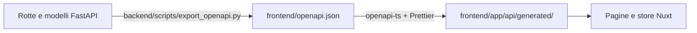

# Client API tipizzato (OpenAPI → TypeScript)

Le rotte FastAPI e i modelli Pydantic/SQLModel sono la **fonte di verità** del
contratto API. Il generatore fissato [`@hey-api/openapi-ts`](https://heyapi.dev/)
0.87.5 produce dallo schema OpenAPI un SDK basato su Fetch e i tipi TypeScript di
ogni operazione.



## Aggiornare il contratto

Dopo ogni modifica a rotte, parametri o modelli del backend:

```sh
make api_generate   # esporta lo schema e rigenera SDK e tipi
make typecheck      # verifica che il frontend compili con il nuovo contratto
make api_check      # verifica senza riscrivere (lo fa anche la CI)
```

Da `frontend/`: `bun run api:generate` e `bun run api:check`.

- L'export usa l'ambiente Python bloccato (`uv run --locked`) e **non richiede**
  backend, PostgreSQL, Redis o SMTP in esecuzione: lo script imposta, solo nel
  proprio processo, una configurazione fittizia e un database SQLite e non legge
  il tuo `.env`.
- L'output viene formattato con la configurazione Prettier del progetto e
  pubblicato solo se export e generazione riescono entrambi.
- `api_check` rigenera in una directory temporanea e confronta schema e tutti i
  file (inclusi file aggiunti o rimossi). È incluso in `make check` e nella CI.

Committa `frontend/openapi.json` e `frontend/app/api/generated/` **insieme** alla
modifica del backend. Non modificare a mano i file generati. Il build del
frontend usa l'SDK committato e non ha bisogno di Python.

La configurazione del generatore è in `frontend/openapi-ts.config.mjs`
(plugin `@hey-api/typescript`, `@hey-api/client-fetch` con `throwOnError`,
`@hey-api/sdk` con `responseStyle: "data"`).

## Nomi delle funzioni

FastAPI genera gli `operationId` come `{primo_tag}_{nome_funzione}` (vedi
`operation_id` in `backend/app/main.py`); il generatore li converte in camelCase:

| Backend | SDK |
| --- | --- |
| tag `users`, funzione `read_user_me` | `usersReadUserMe` |
| tag `login`, funzione `login_with_oauth2` | `loginLoginWithOauth2` |
| tag `documents`, funzione `create_document` | `documentsCreateDocument` |

Quindi:

- dai a ogni router un tag (`include_router(..., tags=["documents"])`);
- mantieni i nomi delle funzioni unici all'interno di un tag (un test backend
  verifica l'unicità degli `operationId`);
- rinominare un tag o una funzione cambia il nome esportato nell'SDK.

Dichiara sempre i modelli di request e response (tipo di ritorno o
`response_model`): senza, i tipi generati sono generici (`unknown`).

## Uso in Nuxt

Il plugin `app/plugins/api.ts` fornisce due client per ogni istanza dell'app:

| Client | Quando usarlo |
| --- | --- |
| `$api` | Rotte dell'utente autenticato. Aggiunge il Bearer, rinnova il token una volta dopo un `401`, esegue il logout se il rinnovo fallisce, mostra un toast per i `403`. I rinnovi concorrenti sono deduplicati. |
| `$publicApi` | Login, signup, refresh, recupero password, contatti. Nessun token automatico: passa gli header espliciti se servono. |

La base URL è `NUXT_PUBLIC_API_URL`, letta a runtime.

### Lettura

```vue
<script setup lang="ts">
import { usersReadUserMe } from "~/api/generated"

const { $api } = useNuxtApp()
const { data: profile, error } = await useAsyncData("my-profile", () =>
  usersReadUserMe({ client: $api }),
)
</script>
```

Il tipo della risposta è inferito dalla funzione.

### Scrittura con body tipizzato

```ts
import { usersUpdateUserMe } from "~/api/generated"
import type { CustomUserUpdate } from "~/api/generated"

const { $api } = useNuxtApp()

async function changeLanguage(language: string, original: string) {
  const body: CustomUserUpdate = { language, original }
  return await usersUpdateUserMe({ client: $api, body })
}
```

### Parametri di path e query

```ts
await usersReadUserById({ client: $api, path: { user_id: id } })
```

### Form e header espliciti

Il login OAuth usa la serializzazione form definita nello schema:

```ts
import { loginLoginWithOauth2 } from "~/api/generated"

const { $publicApi } = useNuxtApp()
const tokens = await loginLoginWithOauth2({
  client: $publicApi,
  body: { username: "user@example.com", password: "password" },
})
```

Per refresh o challenge passa l'header: `headers: { Authorization: \`Bearer ${token}\` }`.

### Errori

Con `throwOnError` le funzioni restituiscono i dati già parsati e **rigettano** in
caso di errore HTTP: usa `try/catch` o l'`error` di `useAsyncData`. I tipi
descrivono il contratto ma non validano a runtime le risposte.

## Linee guida

- Importa funzioni e tipi direttamente da `~/api/generated`: non servono wrapper
  scritti a mano per ogni endpoint.
- Comportamenti trasversali (URL, autenticazione, rinnovo) stanno nel plugin e nel
  transport; comportamenti applicativi (stato di sessione, notifiche) negli store.
- I tipi specifici della UI restano separati da quelli del contratto; normalizza
  nella UI i valori opzionali o `null` senza modificare i tipi generati.
