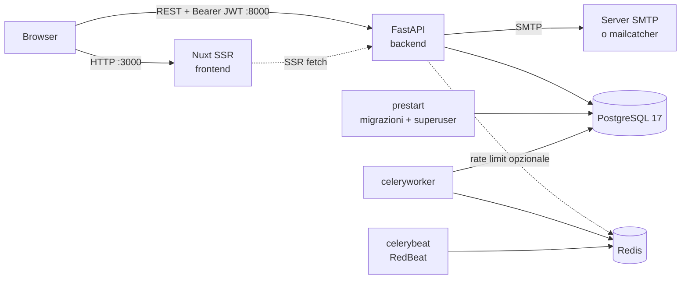

# Architettura

## Panoramica



- Il **frontend** Nuxt viene renderizzato lato server e poi idratato. Le chiamate
  API partono dal browser (o dal server Nuxt durante l'SSR) direttamente verso
  il backend, con l'URL di `NUXT_PUBLIC_API_URL`. Il frontend non fa da proxy.
- Il **backend** FastAPI è stateless: l'autenticazione usa JWT firmati
  (`SECRET_KEY`) con refresh token salvati come hash nel database.
- **Redis**, **Celery** e gli strumenti di amministrazione sono opzionali e si
  attivano con i profili Compose.

## Struttura della repository

```text
.
├── backend/                   # API FastAPI (pacchetto Python "app")
│   ├── app/
│   │   ├── main.py            # create_app(): middleware, router, health check
│   │   ├── router.py          # aggrega i router dei moduli
│   │   ├── models.py          # importa i modelli di tutti i moduli (per Alembic)
│   │   ├── crud.py            # CRUDBase generico
│   │   ├── deps.py            # SessionDep condivisa
│   │   ├── core/              # config, engine DB, app Celery
│   │   ├── src/               # moduli di dominio
│   │   │   ├── auth/          # autenticazione (fastapi-myauth) e utenti
│   │   │   ├── chat/          # scheletro
│   │   │   ├── editor/        # scheletro
│   │   │   └── bpmn/          # scheletro
│   │   ├── worker/            # task Celery
│   │   ├── backend_pre_start.py, initial_data.py, maintenance.py, ...
│   │   └── logging_conf.py
│   ├── alembic/               # migrazioni
│   ├── scripts/               # export OpenAPI, runner dei test
│   ├── tests/                 # pytest
│   ├── backend.Dockerfile     # target development e production
│   ├── prestart.sh, worker-start.sh
│   └── pyproject.toml, uv.lock
├── frontend/                  # applicazione Nuxt 4
│   ├── app/                   # sorgenti (srcDir di Nuxt 4)
│   │   ├── api/               # transport auth + SDK generato
│   │   ├── components/ layouts/ middleware/ pages/ plugins/ stores/ utilities/
│   │   └── app.vue, app.config.ts, error.vue
│   ├── content/{en,it}/       # contenuti Nuxt Content
│   ├── i18n/locales/          # traduzioni UI
│   ├── public/                # asset statici
│   ├── tests/                 # bun test (logica); tests/nuxt/ Vitest (UI)
│   ├── openapi.json           # schema API committato
│   ├── nuxt.config.ts, content.config.ts, openapi-ts.config.mjs
│   └── Dockerfile, Dockerfile.dev, package.json, bun.lock
├── scripts/                   # init.py (configurazione), test.sh (test isolati)
├── tests/                     # test del tooling della repo (unittest)
├── docs/                      # questa documentazione
├── .github/                   # CI, CD, dependabot, template community
├── .devcontainer/             # ambiente di sviluppo containerizzato
├── docker-compose.yml         # stack base / produzione
├── docker-compose.override.yml# aggiunte per lo sviluppo
├── docker-compose.test.yml    # stack usa e getta per i test
├── Makefile                   # punto d'ingresso per tutti i comandi
└── .env.example               # nomi delle variabili, segreti vuoti
```

## Servizi Docker Compose

`docker-compose.yml` descrive lo stack di produzione; `docker-compose.override.yml`
viene aggiunto solo dai target `dev_*` di Make e cambia target di build, porte e
watch.

| Servizio | Profilo | Ruolo | Porta (solo sviluppo) |
| --- | --- | --- | --- |
| `db` | core | PostgreSQL 17 (`postgres:17-alpine`), volume `app-db-data` | 127.0.0.1:5432 |
| `prestart` | core | Attende il DB, `alembic upgrade head`, crea il superuser; poi termina | — |
| `backend` | core | FastAPI; parte solo dopo `prestart` completato con successo | 127.0.0.1:8000 |
| `frontend` | core | Nuxt (dev server in sviluppo, server Nitro/Bun in produzione) | 127.0.0.1:3000, 24678 (HMR) |
| `queue` | `workers`, `tools` | Redis 7.4, volume `app-redis-data` | 127.0.0.1:6379 |
| `celeryworker` | `workers` | Worker Celery sulla coda `main-queue` | — |
| `celerybeat` | `workers` | Scheduler Celery con RedBeat | — |
| `pgadmin` | `tools` | pgAdmin 4 | 127.0.0.1:5050 |
| `flower` | `tools` | Monitor Celery (basic auth) | 127.0.0.1:5555 |
| `mailcatcher` | `tools` (solo override) | SMTP finto + UI web | 127.0.0.1:1080, 1025 |

In sviluppo le porte sono pubblicate solo su `127.0.0.1`. Il file di produzione
non pubblica porte sull'host (solo `expose`): l'accesso passa da un reverse proxy
collegato alla rete Compose (vedi [Deployment](deployment.md)).

Le immagini sono `${IMAGE_PREFIX}/backend:${TAG}` e `${IMAGE_PREFIX}/frontend:${TAG}`
(in sviluppo `backend-dev`/`frontend-dev`). `prestart`, `celeryworker` e
`celerybeat` riusano l'immagine del backend.

## Backend: anatomia di un modulo

Ogni dominio applicativo vive in `backend/app/src/<modulo>/` con la stessa forma:

```text
src/<modulo>/
├── api/
│   ├── api.py          # APIRouter del modulo, include gli endpoint
│   ├── deps.py         # dipendenze FastAPI specifiche
│   └── endpoints/      # un file per gruppo di rotte
├── models/             # SQLModel: tabelle e schemi di input/output
├── crud/               # accesso ai dati (istanze di CRUDBase o sottoclassi)
├── config.py           # BaseSettings del modulo (variabili d'ambiente proprie)
└── service.py          # logica di dominio che compone più operazioni CRUD
```

Il modulo si collega all'applicazione in due punti:

1. `backend/app/router.py` include `api_router` del modulo;
2. `backend/app/models.py` importa il pacchetto `models` del modulo, così Alembic
   vede le tabelle per l'autogenerazione.

Il tutorial [Nuova funzionalità](tutorial-feature.md) percorre tutti i passi.

## Flusso di una richiesta autenticata

1. Il frontend chiama una funzione dell'SDK generato con `client: $api`.
2. Il transport (`frontend/app/api/transport.ts`) aggiunge
   `Authorization: Bearer <access_token>`.
3. FastAPI applica `RateLimitMiddleware` e `CORSMiddleware`, poi risolve le
   dipendenze: `SessionDep` apre una sessione in una transazione, `CurrentUser`
   valida il JWT e la versione di sessione dell'utente.
4. L'endpoint usa CRUD e servizi sulla stessa sessione. Alla fine della richiesta
   la transazione viene committata; un'eccezione la annulla interamente.
5. Se l'API risponde `401`, il transport rinnova il token una volta tramite
   `/login/refresh` e ripete la richiesta; se fallisce ancora esegue il logout.
   Un `403` mostra una notifica di permesso negato.

## Contratto API

Lo schema OpenAPI del backend è la fonte di verità. `make api_generate` lo esporta
in `frontend/openapi.json` e genera tipi e SDK in `frontend/app/api/generated/`.
La CI fallisce se gli artefatti committati non corrispondono al backend. Dettagli
in [Client API](api-client.md).

## Stato dei moduli

| Componente | Stato |
| --- | --- |
| `auth` (backend + frontend) | Completo e testato: password, magic link, TOTP, sessioni, ruoli, email |
| `chat`, `editor`, `bpmn` (backend) | Scheletri vuoti: nessuna rotta, nessun modello, nessuna logica |
| Editor BPMN (frontend) | Demo client-side con Vue Flow; nessun salvataggio |
| Landing, blog, docs, changelog, pricing | Contenuti demo statici da Nuxt Content |
| Social login, passkey | Supportati da `fastapi-myauth` ma non configurati né esposti nella UI |
| Ri-autenticazione, login con recovery code, rigenerazione recovery code | Endpoint disponibili, UI non ancora presente |

Non presentare le pagine demo come prova di funzionalità backend che non esistono.
